# DiscWise Audio Archive Manager

**An automated, start-to-finish workflow for archiving a large FLAC collection onto discs. DiscWise automatically checks your music, cleans it, adds the cover art, packs it onto the fewest discs, tracks every burn, and makes space-saving MP3 copies, all in one window.**

DiscWise is a free Linux desktop app. It was built by someone who wanted to archive a big FLAC collection to DVD-R without losing track of anything, and it is designed to automate as much of that job as possible. The whole process is automated except the physical burn itself, which you do in your favorite burning program. Even then, DiscWise automatically prepares each disc, keeps track of it, and checks it afterward.

It is written to be usable by someone who isn't a computer person. Nearly every button, box and table column has a tooltip: hold your mouse over it and a short note pops up explaining what it does and how to use it. The tooltips guide you along the path, help you make choices with confidence, and explain how each step fits into the bigger workflow, so you rarely need to look anything up. The wording is plain, the results are big, and nothing changes on your drive until you say so.

<p align="center">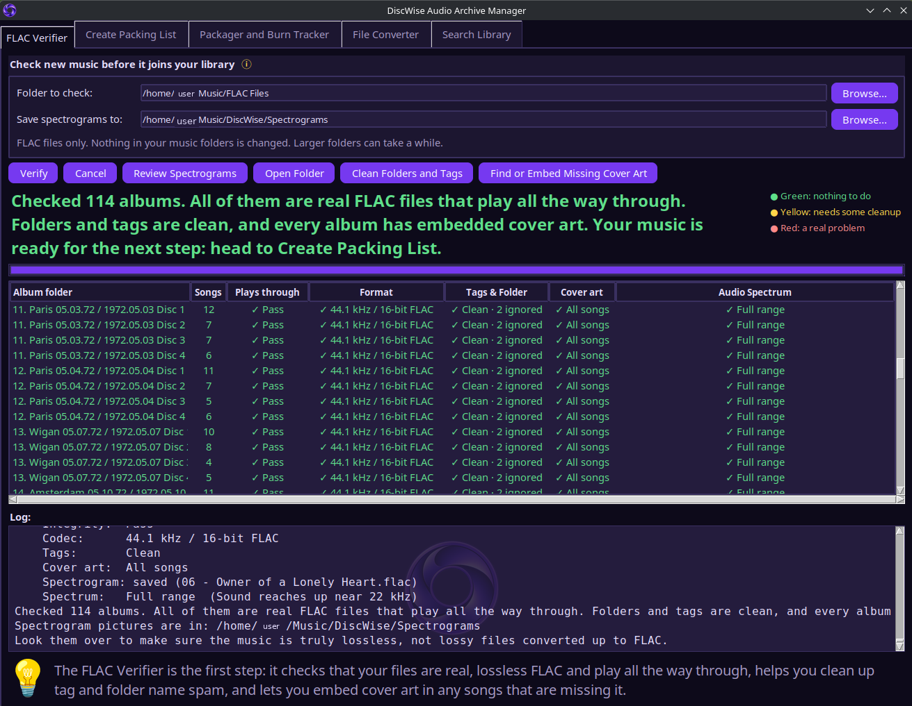<br><em>The FLAC Verifier: every album checked, with green rows meaning nothing to do.</em></p>

---

## The idea: automate the whole archiving process

Archiving a few hundred albums by hand means hundreds of small chores: checking files, fixing tags, finding covers, working out what fits on which disc, remembering what's been burned. DiscWise turns that into one automated workflow. Each tab is a stop along the way, and each stop automatically hands its result to the next.

![DiscWise workflow: Latest Downloads folder; Verify FLAC integrity, codec and spectrum; Clean tags and folder names; Find, embed, or replace cover art; Automatically creates best-fit packing list groups; Automatically assemble each disc from the packing list; Grouped files move to Waiting to Burn folder; Burn physical copies of FLAC files (the only step the system cannot monitor); Verify disc matches the packing list; Automatically marks it Burned and Verified in the checklist; Optional: files move to Need to Be Converted folder; MP3 copies made, FLACs deleted if you choose.](discwise-workflow.svg)

You point DiscWise at your music and review what it found. It does the checking, cleaning, matching, packing and bookkeeping automatically, and it always shows you its plan before it changes anything.

## The workflow

### 1. Verify: is it really lossless?
Point it at a folder of new downloads and it automatically checks every album:

- **Integrity:** does every file play all the way through?
- **Codec:** is it really FLAC, and at what sample rate and bit depth?
- **Spectrum check:** an automatically saved spectrogram picture for each album, plus an automatic check of whether the sound reaches up near the top of the range. A lossy file (MP3 or similar) that was converted up to FLAC stops at a sharp line, and you can see it.
- **Tags and cover art:** are the tags tidy, and does every song have its picture?

Results are color-coded automatically: green means nothing to do, yellow means some cleanup, red means a real problem.

<p align="center">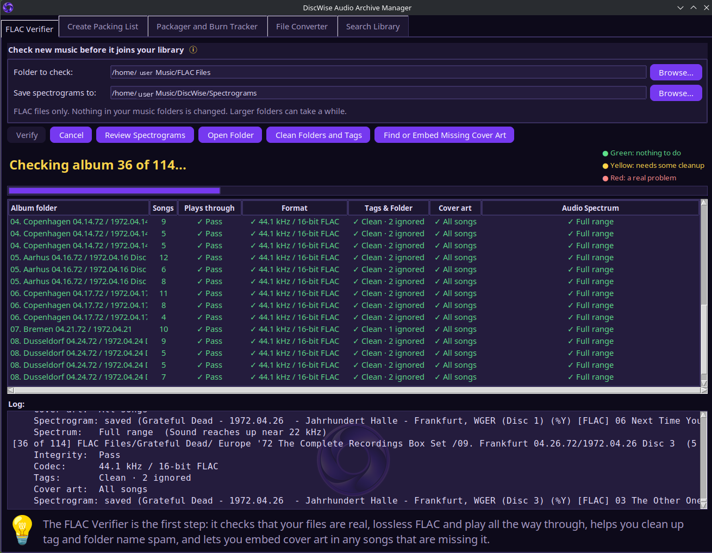<br><em>The FLAC Verifier at work, checking album 36 of 114. Each finished album gets its own color-coded row.</em></p>

<p align="center">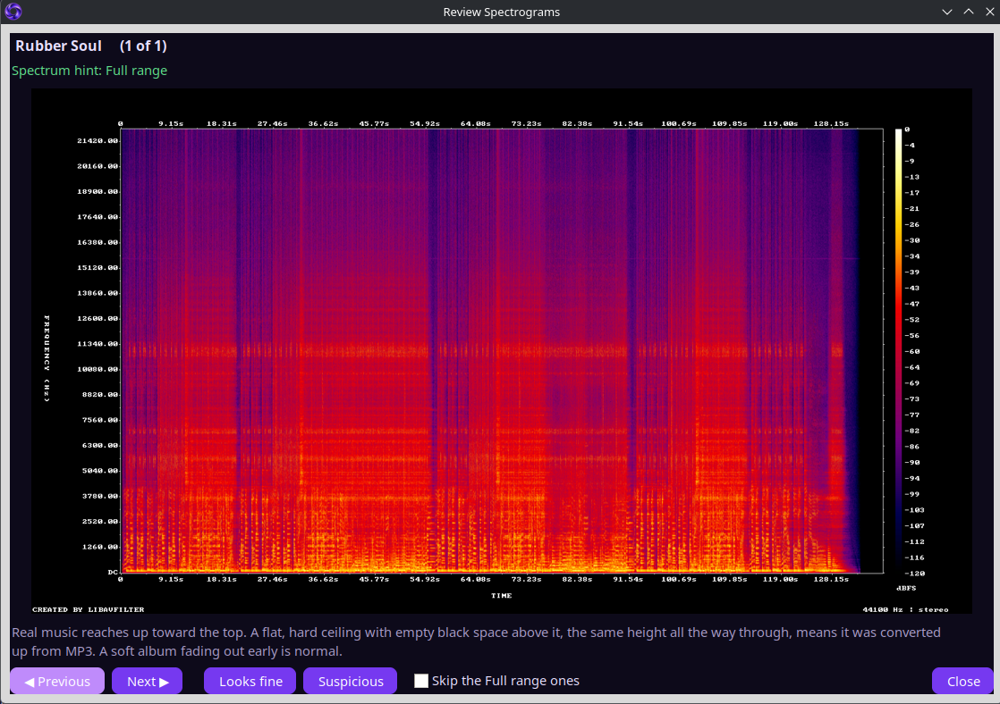<br><em>Review Spectrograms: the sound of this album reaches up toward the top of the range, which is what real lossless music looks like. The hint at the top says "Full range."</em></p>

<p align="center">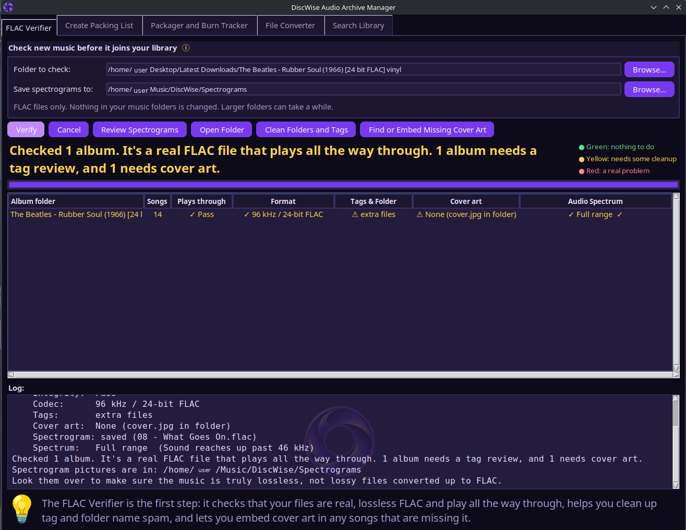<br><em>A folder that needs work: the music is real FLAC and plays all the way through, but this album is flagged yellow for extra files, and it has no embedded cover art (a picture named cover.jpg is just sitting in the folder).</em></p>

### 2. Clean: tags and folders
Automatically finds messy song titles, extra text stuck on artist and album names (such as catalog numbers), and disc numbering for multi-disc sets (Disc 1, Disc 2...). It also flags the leftover extra files that come along with downloads, such as .txt notes, rip logs, dynamic range (DR) reports and .m3u playlists, so they don't clutter your albums or end up on your discs. It shows you what it found first. Nothing is changed until you approve it, and you can tell it to ignore a folder. Extra files are never deleted: approved ones are moved to a holding folder, and Undo brings them back. Cue sheets and pictures are left alone.

It also catches **take notes**: session labels like "(RS1 take 3)" stuck on the end of nearly every song name, which are easy to miss because the numbers change from song to song. When about four out of every five songs on an album end with the same kind of note, DiscWise flags it and offers to remove it from both the song titles and the file names, and it leaves albums alone where only a few songs have one. Undo puts the old names back.

For the rare album the automatic cleanup can't fix, **Edit Tags by Hand** is the last resort. Change the album, artist, album artist, year or genre for every song at once, or double-click any single song to edit its track number, title, artist or file name. Nothing is written until you press Save Changes, and Undo takes it all back. Most of the time DiscWise finds and fixes these problems for you, so you will rarely need it.

<p align="center">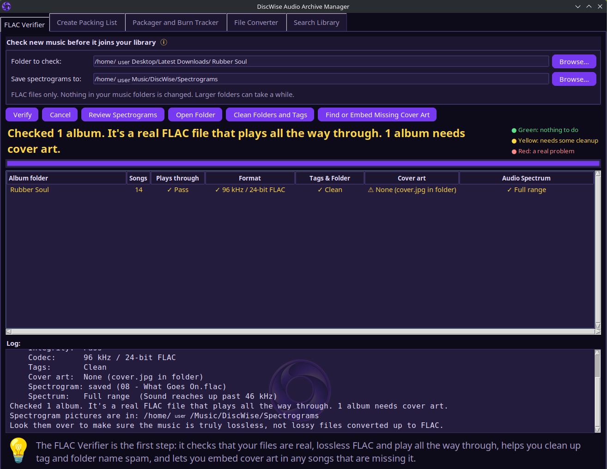<br><em>The same album after cleanup: the folder has a tidy name and Tags &amp; Folder now says Clean. The cover art is still flagged, which is the next step.</em></p>

### 3. Cover Art: find it, embed it, or replace it
Many players only show a cover if it is *inside* the song file, so DiscWise automates that part:

- If a picture is already sitting in the album folder, DiscWise automatically **embeds** it into the songs.
- If there isn't one, DiscWise automatically **goes online and finds the cover without leaving the app.** It searches iTunes, Deezer and MusicBrainz (with the Cover Art Archive), shows you thumbnails, and you pick the right one. No accounts or keys are needed.
- **Don't like the cover that came with the album?** Maybe it's a Japanese edition, or just not the version you want. You can replace it: DiscWise goes online, finds a different version of the cover, shows you thumbnails, and you pick the one you like.
- Songs that already have art are left alone unless you choose to replace it, every change is logged, and **Undo** takes the pictures back out.

<p align="center">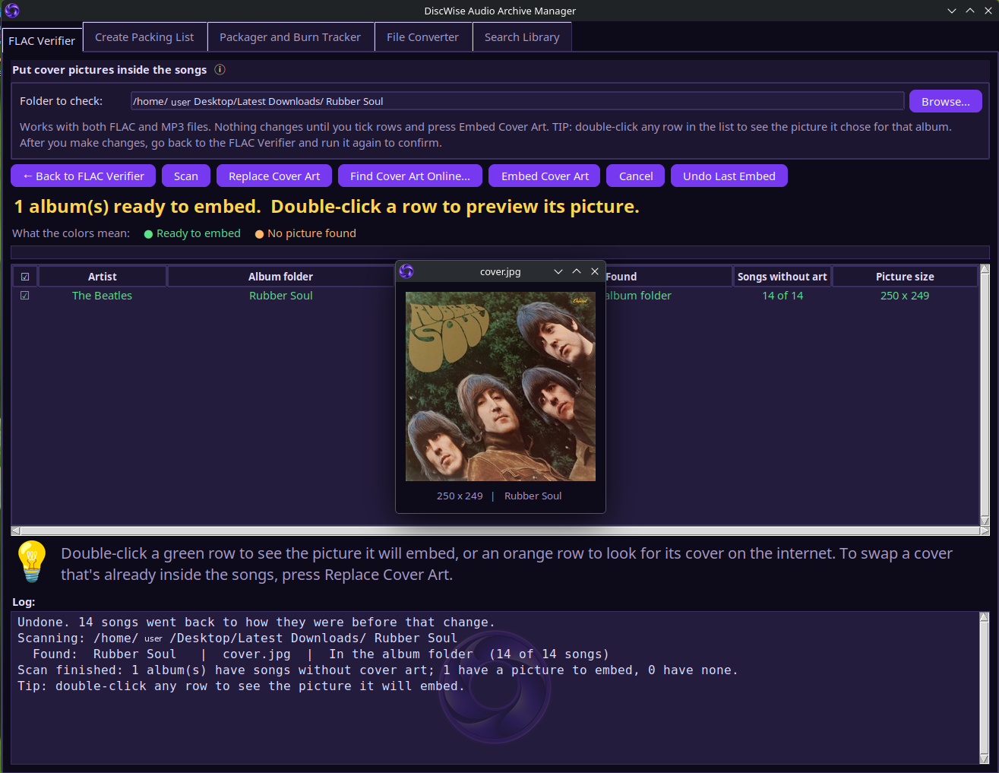<br><em>The Cover Art Embedder: it found cover.jpg in the album folder and shows a preview of the picture before anything is embedded. Double-click a row to see it.</em></p>

<p align="center">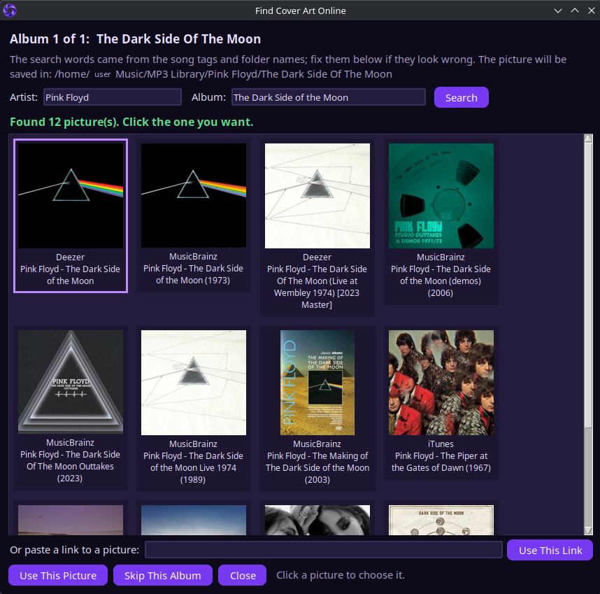<br><em>Find Cover Art Online: thumbnails from several services, and you click the one you want.</em></p>

### 4. Packing List: what goes on which disc?
Automatically scans your music library and works out how to fit everything onto the fewest discs (DVD-R, dual-layer DVD, Blu-ray, or dual-layer Blu-ray). It never splits an album across discs unless the album by itself is too big for one disc (over 4.7 GB on a standard DVD-R, such as a two-disc album or a long box-set disc), and then it offers to split it for you. You get, automatically:

- An **Excel/LibreOffice checklist** with every disc's contents, space used, and boxes for Burned and Verified. It is handy for writing disc labels and jewel-case inserts too.
- A **searchable database** of every artist, album and track and the disc each one lives on.
- **Backups** of the previous plan each time you pack.

Your packing list is flexible. Think of burned versus unburned as a line in the sand: discs you have marked burned stay exactly as they are, and everything after the line can be repacked as often as you like, even in the middle of a burning project. Add new albums to your music folder, make a new packing list with **Keep burned discs as they are** ticked, and DiscWise folds the new music into the discs that haven't been burned yet, so you don't end up with half-empty discs. If you burn, convert and delete as you go, the **Add to existing** option carries the disc numbering on instead.

<p align="center">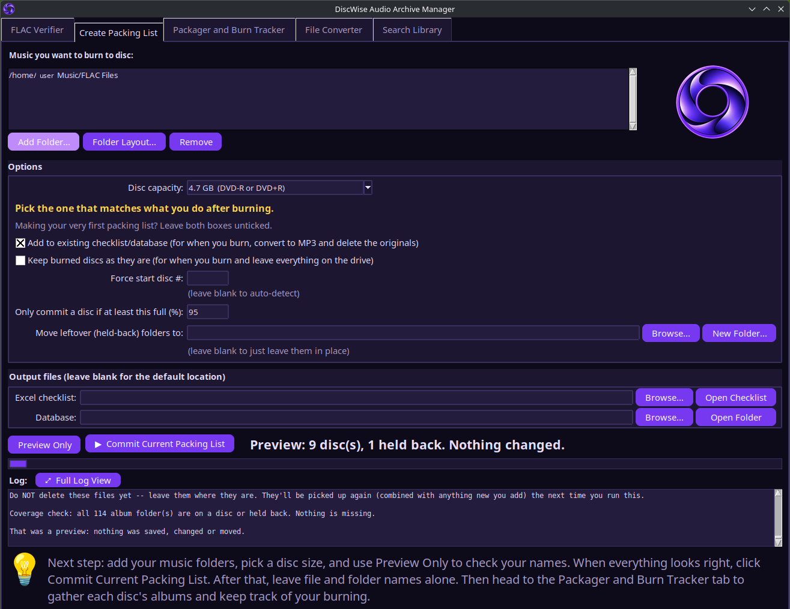<br><em>Create Packing List in preview mode: 9 discs, 1 held back, and nothing changed yet.</em></p>
<p align="center">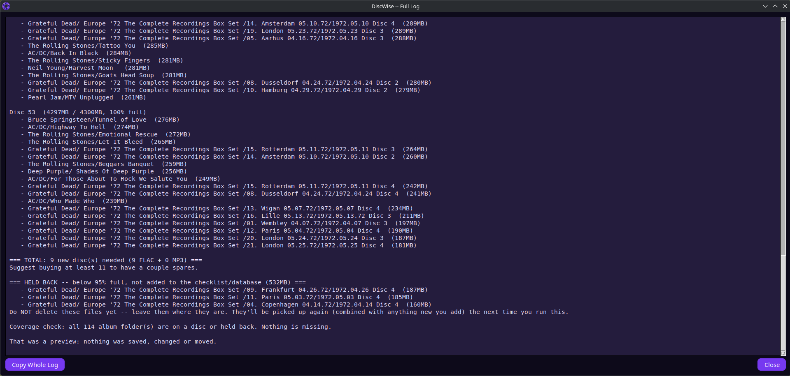<br><em>The Full Log view lists exactly what goes on each disc.</em></p>

### 5. Burn and Verify: automated tracking
DiscWise does not burn discs itself. Use your favorite burning program (K3b, Brasero and so on). That is the only step you do by hand. Everything around the burn is automated:

- **Assemble Disc** automatically gathers one disc's albums into a single folder, ready to drag into your burning program in one go.
- **Burn Tracker** keeps automatic track of which discs are burned and verified. You never have to tick the Burned box yourself: verifying a disc does it for you.
- **Verify Disc** automatically checks an inserted disc against the plan: albums, files, sizes, and (optionally) a full read of every file. If it checks out, DiscWise automatically marks the disc both Burned and Verified, then ejects it. Even if you left the Burned box blank for that disc, the built-in verifier checks it off for you, so all the bookkeeping is done without you editing the checklist.
- **After a disc is verified, the archiving is done.** Your music is safely on disc, and what happens next is up to you. You can simply leave your FLAC files where they are and keep listening to them. Or, if you choose, you can have the albums moved to the **Need to Be Converted** folder so they can be converted to high-quality MP3s (see step 6), and then delete the FLAC files to get your drive space back, since they are now safe on disc. Some people will stop right here, and that is a perfectly good ending.

<p align="center">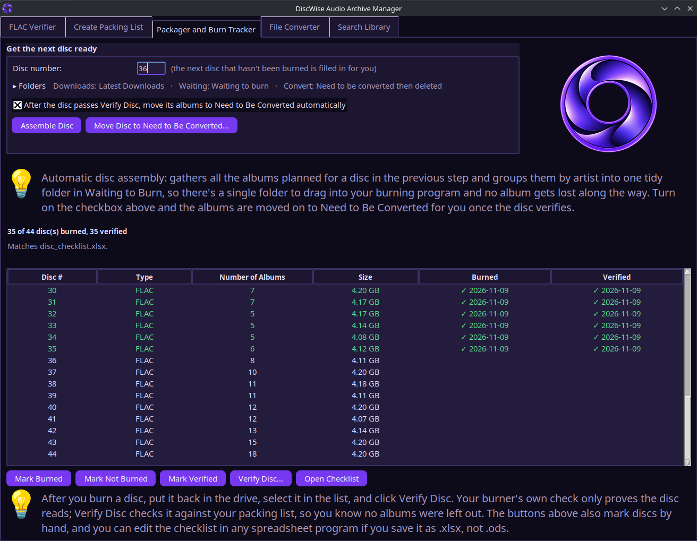<br><em>The Packager and Burn Tracker tab: assemble a disc, then keep track of which discs are burned and verified.</em></p>

### 6. Convert: automatic MP3 copies to get your space back
Once your FLACs are safely on discs, the **File Converter** automatically makes MP3 copies (320 kbps) that keep the same folder layout, tags and cover art, so you can reclaim drive space and keep listening. Your FLACs are never touched unless you explicitly choose to delete them after the check. The conversion can be stopped and restarted where it left off.

<p align="center">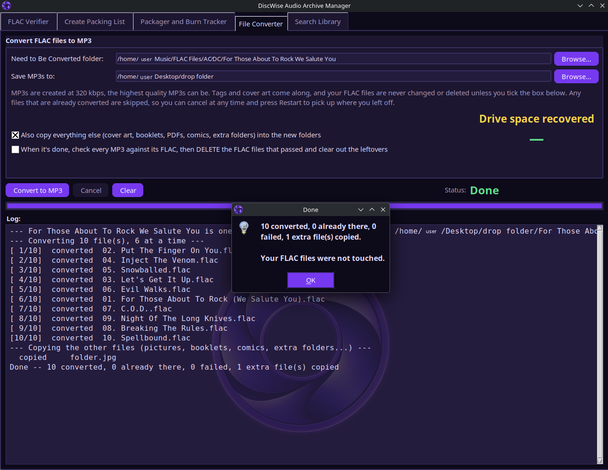<br><em>The File Converter after a run: 10 songs converted, and the FLAC files were not touched.</em></p>

### Search: find anything, any time
Searching is a good place to have some fun with your music collection: look things up by artist, album, song title or a word from a title, and see what turns up. It is also a good way to take stock of what you own. Search an artist and you can see which of their albums you have, so any holes in the collection stand out. And before you download an album, search for it first. It's easy to get excited about something, and two years later not remember whether you ever got the whole album. A quick search tells you.

- **Search Library** is a standalone feature: add the folders where your everyday music lives, press Scan Library, and search by artist, album or song (even when the music isn't on your drive any more). It works with or without the rest of the workflow.
- **Search Burned Discs** looks up a song, album or artist and tells you which disc it's on, and whether that disc is Pending, Burned, or Burned + Verified. Discs you verified are logged automatically, so you can look back later and see what was burned, verified or still pending. Typing `pending` lists everything not burned yet.

<p align="center">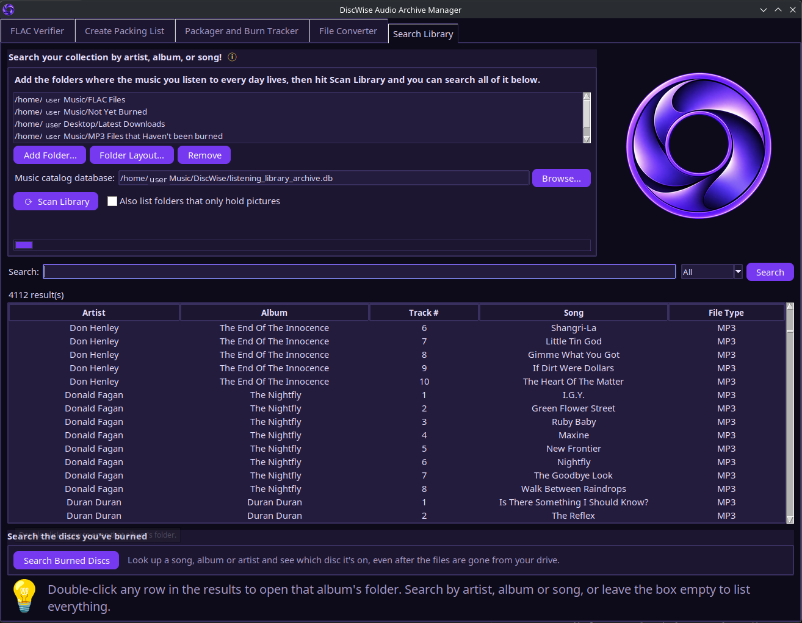<br><em>Search Library: look up any artist, album or song across the music on your drive.</em></p>
<p align="center">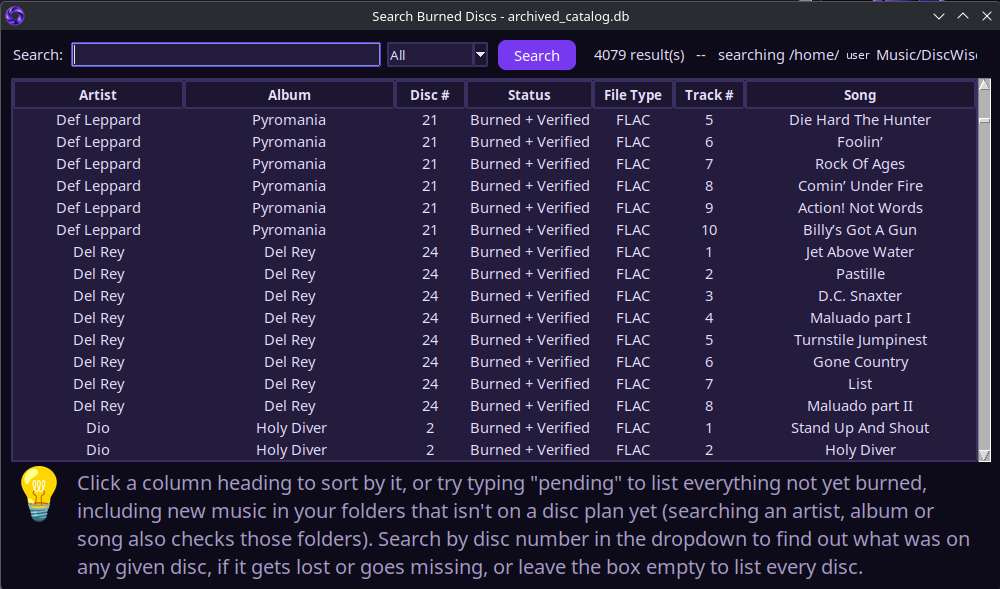<br><em>Search Burned Discs: see which disc a song is on, and whether it is Pending, Burned, or Burned + Verified.</em></p>

&nbsp;<br>&nbsp;<br>&nbsp;<br>&nbsp;<br>&nbsp;<br>&nbsp;

## What's automatic and what you have to do

&nbsp;

| <h3><u><ins>You do this</ins></u></h3><br>&nbsp; | &emsp;&emsp;&emsp;&emsp; | <h3><u><ins>DiscWise does this automatically</ins></u></h3><br>&nbsp; |
|---|---|:---:|
| **Choose the folder to check**<br>&nbsp; | | Checks integrity, codec and spectrum for every album<br>Finds tag and folder problems<br>Finds missing covers online<br>Suggests changes<br>&nbsp; |
| **Approve the changes, including selecting or replacing art**<br>&nbsp; | | Applies the tag and folder fixes you approved<br>Embeds the cover pictures into the songs<br>&nbsp; |
| **Choose the disc type**<br>&nbsp; | | Automatically creates best-fit packing list groups sized for that disc type<br>Builds the checklist and the searchable database<br>&nbsp; |
| **Pick the next disc to assemble**<br>&nbsp; | | Automatically assembles that disc's albums into one folder<br>Moves the grouped files to the Waiting to Burn folder<br>&nbsp; |
| **Burn the disc** in your burning program<br>&nbsp; | | &nbsp; |
| **Put the burned disc in the drive**<br>&nbsp; | | Verifies the disc against the plan and reads every file all the way through<br>If it passes, marks it Burned and Verified automatically (no need to check off Burned yourself) and ejects it<br>If you choose, moves the albums to the Need to Be Converted folder for MP3 conversion<br>Tracks which discs are burned and verified<br>&nbsp; |
| **Decide whether to delete the FLACs afterward** | | If yes, DiscWise can make MP3 copies with the same folders, tags and art,<br>then deletes the original FLAC files |

---

## Install

DiscWise is Linux-first and is developed and used on Ubuntu. Other Linux distributions should work; macOS and Windows haven't been tried.

### Easiest way: the installer file (Ubuntu, Kubuntu and Debian)

1. Download the latest **`.deb`** file from the project's Releases page.
2. **Double-click it.** Your software center opens with an **Install** button.
3. Click **Install** and type your password when asked. Anything else DiscWise needs is added for you.
4. Find **DiscWise** in your applications menu.

No typing in a terminal is needed to install it. To update later, double-click the newer `.deb`.

**To remove DiscWise**, open a terminal and run:

```
sudo apt remove discwise
```

(Some software centers also list DiscWise and let you remove it there, but the command always works.) Your music and your DiscWise settings are not touched.

If double-clicking opens something other than your software center, right-click the file, choose **Open With**, and pick your software center (Discover or Software Install).

### Other ways (other Linux systems, or if you like doing it by hand)

**1. System packages** (Ubuntu / Debian):

```bash
sudo apt install python3 python3-tk python3-pil python3-pil.imagetk \
    python3-mutagen python3-openpyxl python3-ttkthemes flac ffmpeg
```

What each is for:

| Package | Used for |
|---|---|
| `python3-tk`, `python3-ttkthemes` | The window and its look |
| `python3-pil`, `python3-pil.imagetk` | Logos, cover art, spectrograms |
| `python3-mutagen` | Reading and writing FLAC tags and pictures |
| `python3-openpyxl` | The disc checklist spreadsheet |
| `flac`, `ffmpeg` | Integrity checks, spectrograms, and MP3 conversion |

**2. Get DiscWise:**

```bash
git clone https://github.com/YOUR-NAME/discwise.git
cd discwise
```

**3. Run it:**

```bash
python3 disc_planner_gui.py
```

---

## Where things are kept

DiscWise keeps its own files (databases, checklists, backups, spectrograms) together in one **DiscWise** folder beside your music folders, so your music folders stay clean. Settings are remembered between sessions in a small file. When you installed DiscWise from the `.deb`, that file and the program's logs are kept in `~/.local/share/discwise`; when you run it from a folder you can write to, they sit next to the program.

## A promise about your music

Automated doesn't mean unattended. DiscWise is careful by design:

- It shows you what it plans to do before it does it.
- Changes are written to a temporary copy first and swapped in only after the copy checks out.
- Embedded pictures and tag changes are logged, and the cover art and cleanup steps have **Undo**.
- It never overwrites a picture that is already there unless you choose to replace it.
- The converter never alters your FLAC files.

Still, **back up music you care about before running any tool on it.**

---

## What it is made of

The workflow is one program, but the parts live in separate files:

| File | Job |
|---|---|
| `disc_planner_gui.py` | The window and all its tabs |
| `disc_planner.py` | Packing, checklist, databases (also usable from the terminal) |
| `flac_verifier.py` | Integrity, codec, spectrogram and spectrum checks |
| `tag_cleaner.py` | Tag and folder cleanup |
| `art_embedder.py` | Embeds cover pictures |
| `art_finder.py` | Finds covers online |
| `file_converter.py` | FLAC to MP3 |
| `app_icon.png` | The DiscWise logo (window icon, tab logos, and the faint watermark behind the logs) |

## Status

Every part of the workflow has been used on a real library of well over a hundred albums. There is now a one-click installer for Ubuntu and Debian: download the `.deb` file, double-click it, and click Install. The manual steps above are for other Linux setups. The installer has only been tried on a few computers so far, so bug reports are welcome.

## License

*(To be decided. Several pieces of the toolchain, including mutagen, are GPL, so GPL-compatible is the natural choice.)*

## Thanks

Cover art search uses the free public services of iTunes, Deezer, MusicBrainz and the Cover Art Archive. Please be kind to them.
